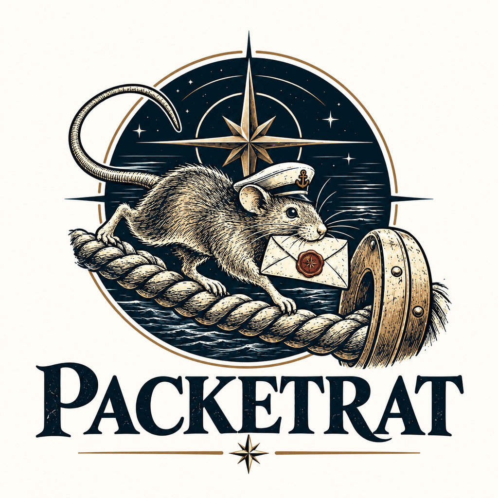
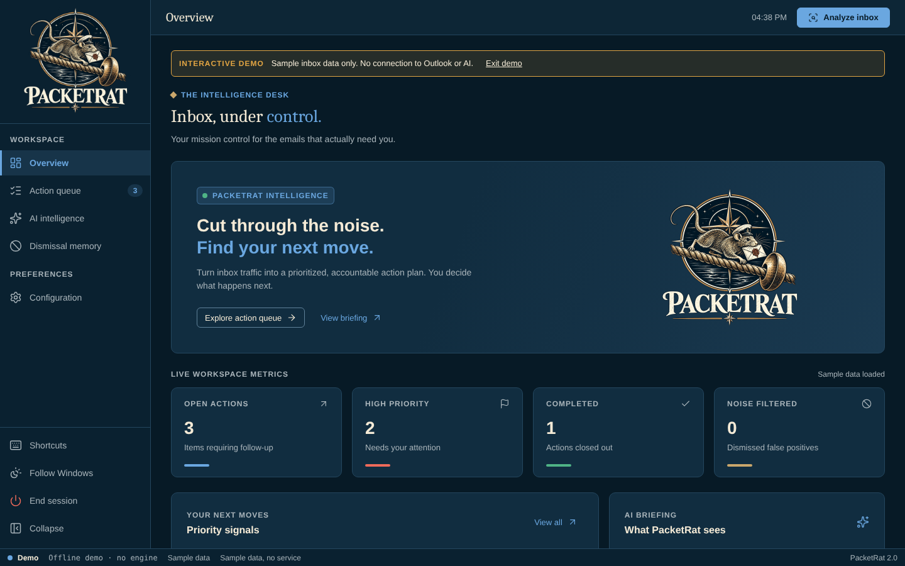
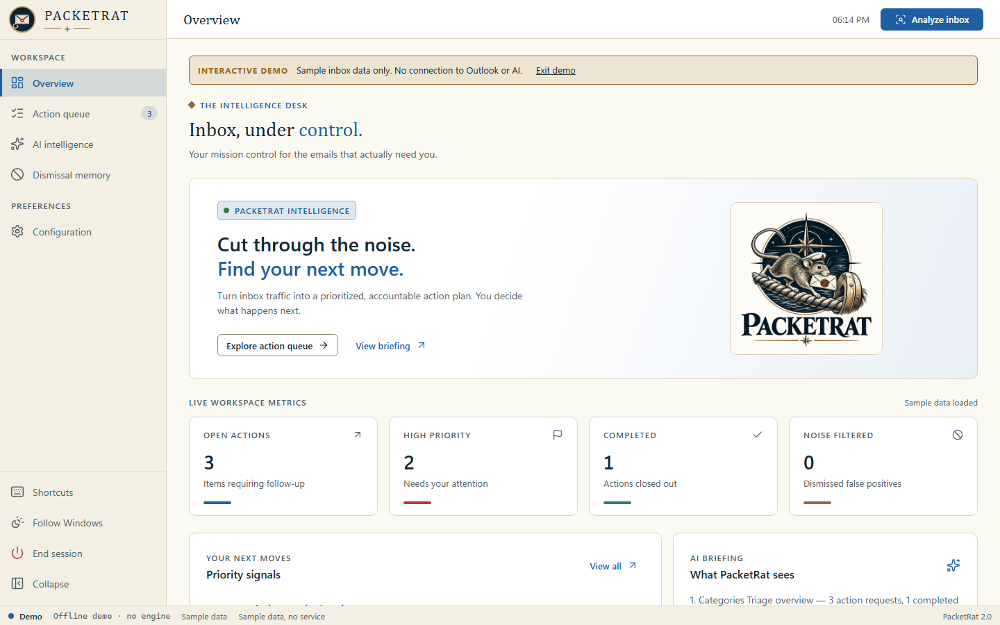

<p align="center">
  <picture>
    <source media="(prefers-color-scheme: dark)" srcset="assets/brand/emblem-dark.png">
    
  </picture>
</p>

# PacketRat

Outlook triage into a human-reviewed action queue, run from a local Windows PowerShell 5.1 service with a browser UI.

No Python or Node.js installation is required on the target workstation.

## The name

Packet ships carried the mail on scheduled routes, and the sailors aboard were called packet rats. PacketRat makes the same run through your Outlook inbox and sorts it into a human-reviewed action queue.

> **Status:** Integrated prototype. Offline/browser functionality has been tested in development; real Outlook COM, Graph, Lazarette/smart card, AI provider connectivity, and operational workstation execution need validation in the approved environment. Not accredited or production-ready.

| Night watch (dark) | Chart room (light) |
| --- | --- |
|  |  |

The screenshots use the offline demo's sample mail. PacketRat follows the Windows light or dark setting; the theme button in the sidebar cycles Follow Windows, Night watch and Chart room.

## Launchers

- **`Launch-PacketRat.bat`** — opens the modern browser GUI, the default.
- **`PacketRat-CLI.bat`** — runs console-only inbox analysis (`-Profile AiEndpoint` or `-Profile Grok`). It also runs any browser action by name, for scripts and agents: `PacketRat-CLI.bat commands` lists them, and [`docs/CLI.md`](docs/CLI.md) covers the flags, JSON output and exit codes.

The browser launcher also supports optional commands from an existing CMD prompt:

```bat
Launch-PacketRat.bat
Launch-PacketRat.bat demo
Launch-PacketRat.bat diagnostics
Launch-PacketRat.bat -NoBrowser
Launch-PacketRat.bat -Port 8766
Launch-PacketRat.bat --replace
Launch-PacketRat.bat --stay
Launch-PacketRat.bat stop
PacketRat-CLI.bat -Profile AiEndpoint
PacketRat-CLI.bat commands
PacketRat-CLI.bat queue show --json
```

### Closing the tab stops PacketRat

The browser tab owns the local PowerShell service. The page sends a heartbeat every 5 seconds and a leaving signal when it closes; the service stops itself 20 seconds after the last heartbeat (5 seconds after a leaving signal), but never while a scan, report, draft or store write is running. A reload or a second PacketRat tab keeps it alive. Other ways to stop it:

- **End session** in the sidebar.
- `Launch-PacketRat.bat stop` (runs `Stop-PacketRat.ps1`), which stops every running PacketRat service without needing a PID.
- Ctrl+C in the console, if it is visible.

Launching while PacketRat already runs asks *Stop it and start fresh?*. `Launch-PacketRat.bat --replace` answers yes; `Launch-PacketRat.bat --stay` (or `PACKETRAT_AUTO_STOP=0` in the environment or `Config/packetrat.env`) keeps the service running after the tab closes. Each running service writes `Logs/packetrat-server-<pid>.json` (pid, port, url, start time; never the session nonce), removed when it stops.

Internal PowerShell files (`Start-PacketRat-Web.ps1`, `Start-PacketRat.ps1`) remain as implementation entrypoints and are not additional launchers.

The PowerShell process-scoped startup convention matches Halyard, but it **cannot override organization-managed security policy**. If the workstation blocks execution, use an approved signing/deployment process. The diagnostics option checks required files, parsing, policy precedence and local network binding without accessing mail or credentials.

## Interactive intelligence report

The report is now an interactive, **source-verified intelligence workspace**, not merely pasted AI model Markdown. It includes:

- Conservative recovery of common encoding artifacts and model formatting, without stripping ordinary Unicode.
- Verified inline source references and clickable table rows when the AI model includes source indices. Invalid model references are never made actionable.
- A searchable list of actual source messages from the most recent inbox scan. Open in Outlook, draft a reply, or explicitly create an action from a report source. A message read through Graph opens in classic Outlook when the same message is in the local profile.
- Generate **Action plan**, **Leadership briefing**, **Risk review**, or **Explanation** from the full report or a selected section; follow-ups are generated on demand and do not send email or silently alter the action queue.
- Report-quality indicators for unresolved character artifacts, unsupported model references, missing structured output, and conflicts between AI suggestions and local triage rules.

Legacy reports without source indices show a verified source list rather than pretending arbitrary prose can be mapped safely to an Outlook message. If the AI model returns incomplete structured output, PacketRat warns instead of displaying partial JSON as trustworthy triage.

See [Deep Report Intelligence Audit](docs/REPORT_INTELLIGENCE_AUDIT.md) for detailed findings, remediation, limitations, and the longer-term schema-first architecture proposal.

**Security:** Mail content and the report are treated as untrusted data. The browser escapes rendered HTML, APIs require a current verified source for report-originated actions, and no AI-generated reply is sent automatically. Use only approved AI endpoints for authorized mail data.

## Standardized AI responses (v1)

PacketRat no longer attempts to interpret free-form AI model replies as email drafts or dashboard reports. It uses three explicit, versioned response contracts:

| Protocol | Output | Handling |
|---|---|---|
| `PACKETRAT_DRAFT_V1` | One suggested subject and one plain-text body, wrapped in exact ASCII markers | Parsed into a single editable response; never duplicate A/B options |
| `PACKETRAT_REPORT_V1` | One JSON envelope with six required sections and indexed source recommendations | Validated and compiled into HTML by PacketRat, with source links grounded in the Outlook scan |
| `PACKETRAT_INSIGHT_V1` | One JSON envelope for action plans, explanations, risk reviews and leadership briefings | Generated on demand and compiled into read-only report content |

Malformed or incomplete outputs fail visibly instead of placing raw model output in the GUI or Outlook. Report serialization uses deterministic section layouts; UTF-8 character handling is kept separate from parsing.

**Outlook signatures:** PacketRat displays the classic Outlook reply first, allowing Outlook to insert the configured reply signature for the chosen account. The AI body is inserted above Outlook's preexisting HTML body without duplicating a signature or erasing quoted content. No signature is invented when none is configured. Suggested subject overrides are always **opt-in** to preserve the original reply thread.

See [AI Wire Protocol v1](docs/AI_WIRE_PROTOCOL_V1.md) for delimiters, schemas, validation, and test requirements. The 20,000-output-token ceiling for drafts remains a provider request budget, not an email length requirement.

## Intelligence workspace

- Overview KPI cards open the matching **Active**, **High priority**, **Completed**, or **Filtered** workspace.
- Priority signals are clickable, and subject titles in the action queue open the original message in desktop Outlook (COM mode).
- An action can be manually upgraded/downgraded High / Medium / Low. Manual overrides survive rescans and can be reset to the AI/rule suggestion.
- **Configuration → Intelligence rules** provides editable, ordered, enableable defaults plus custom sender/domain/subject/preview rules. The filter review lists reversible rule exclusions.
- The report workspace renders AI model Markdown as readable sections, safe tables, and bullets rather than showing raw blockquote chevrons.
- Draft generation requests a **20,000-token output ceiling** (provider permitting) and returns exactly one structured subject/body response. The selected response opens in Outlook for human review only.

The default organization-domain rule requires a **verified direct recipient and actionable language**, and only applies when `PACKETRAT_ORG_DOMAIN` is set in `Config/packetrat.env`. A sender from your organization domain alone does not create a mandatory task. See [Triage Rules and Drafts](docs/TRIAGE_RULES_AND_DRAFTS.md).

## Choosing an AI token source

> **Intelligence router:** the AI endpoint and its token will move behind the Fleet intelligence router, [Fairlead](https://github.com/fleethacker-data-crucible/Fairlead), so PacketRat defaults to the router instead of a fixed endpoint. Routing through Fairlead is available now as an opt-in (off by default): set `PACKETRAT_ROUTER=fairlead` in `Config/packetrat.env`. Until Fairlead is the default, the settings below stay as they are. See [TechStack](TechStack), "Intelligence router".

Open **Configuration → Credentials & connections** in the GUI.

1. Select **Lazarette / configured environment** to use the existing approved Lazarette bridge (AI endpoint item `ai-endpoint-api` or Grok item `grok-api`; override names in `Config/packetrat.env` if needed).
2. Or select **Manual · current session**, select AI endpoint or Grok, paste a token for an **approved** provider, then select **Apply credential source**. Repeat for another provider if needed.
3. Select **Check available token** to verify that the selected provider's token resolves locally. This does **not** contact an AI endpoint or scan your inbox.
4. Select **Forget manual tokens** to erase manual credential references held in the current PowerShell process.

Manual credentials are **not saved to disk, environment files, localStorage, or GitHub** by PacketRat. They are held only in the PowerShell service process while it runs and are cleared on service exit or when switching back to Lazarette. A local process/browser is not an enterprise credential vault; only use this option if permitted under your organization's token-handling policy. Never use unapproved AI endpoints for sensitive or official mail.

**Why “no LLM token” happened:** Earlier browser releases silently searched environment variables/Lazarette without user-configurable source selection. Now the selected source is explicit, errors include useful setup instructions, and **Analyze inbox checks token availability before reading messages**.

`Config/packetrat.env.example` contains optional Lazarette discovery, service names, and provider configuration. By default the `AiEndpoint` profile uses the local phoenix-lai server's OpenAI-compatible API on this PC, `http://127.0.0.1:1234/v1/chat/completions`, with model `phoenixlai` (whichever model phoenix-lai has loaded). Do not commit real token values.

| Variable | Profile | Default | Notes |
| --- | --- | --- | --- |
| `PACKETRAT_AI_ENDPOINT_URL` | AiEndpoint | `http://127.0.0.1:1234/v1/chat/completions` (local phoenix-lai) | Full chat-completions URL. Overrides the default when set. |
| `PACKETRAT_GROK_URL` | Grok | none | Outside provider, so no URL is built in. Required for the Grok profile. |
| `LLM_URL` | any | none | Shared override: wins over both variables above. |
| `LLM_MODEL` | any | `phoenixlai` on the local default, otherwise the profile's model | Set it when an override URL needs a specific model name. |
| `AI_ENDPOINT_TOKEN` / `LLM_TOKEN` | AiEndpoint / any | none | Optional for a local (loopback) endpoint: phoenix-lai's API key is off by default, and no `Authorization` header is sent without a token. Required for a remote endpoint. |

## What works and what still needs verification

| Workflow | State |
|---|---|
| Browser dashboard, inbox action queue, dismissal memory, draft review | Implemented |
| Offline demonstration (`Launch-PacketRat.bat demo`) | No Outlook or LLM connection |
| Inbox actions on the original message: archive, move to a folder, categorize, mark read (queue buttons and `item archive/move/categorize/mark-read`) | Code, UI and offline tests with a fake Outlook; a live check in classic Outlook is still pending. Classic Outlook (COM) only |
| Outlook COM analysis, draft-opening and reply detection | Implementation present; target Windows validation required |
| Lazarette managed credential integration | Implementation present; requires Lazarette unlock/session test |
| Manual credential configuration | Session-only implementation; network/API testing required |
| Microsoft Graph | Requires organization-authorized Graph configuration. Offline tests cover the mapping, sensitivity skip and dismissals against a fake Graph; no live sign-in has been tried |
| Files provider: read exported `.eml` and `.msg` files with no Outlook (`inbox analyze --provider Files --folder <path>`, or `PACKETRAT_MAIL_FOLDER`) | Text and HTML bodies, attachment names only, malformed files listed as errors. `.msg` is parsed by C# source compiled with `Add-Type` (no DLL). Each record keeps its file path and byte offset or line. Offline tests with synthetic files only; not tried on real exports. Inbox actions, open-in-Outlook and reply drafts need classic Outlook, so they are refused for file mail. `--days-back` does not apply to files |
| Minutes-saved counter (`stats`, Overview > Time saved) | An **estimate**, not a measurement. Counts what PacketRat performed or prepared (messages triaged, drafts, reports, inbox actions, dismissals) in the local store (`Logs/`) and multiplies by the minutes assumed per action in `Config/minutes-saved.json` (edit freely; 0-240). Never sent anywhere, never a score for a person. `stats export --out counts.json` writes the raw counts. Offline tests only; the minutes are assumptions, not timings |
| Bridge speaking with the TalkForge voice | Set `PACKETRAT_TTS_DIR` to your TalkForge `assets` folder and run `tools/New-VoiceManifest.ps1`; the server serves TalkForge's engine, runtime and voice model only if they match the recorded SHA-256. Engine load and speech were checked in headless Chromium; not yet heard on a workstation. See [docs/VOICE.md](docs/VOICE.md) |
| Bridge (Overview > Bridge): spoken briefing | "Brief me" reads the top open actions aloud. Speech out uses only voices installed on this PC (never cloud voices; silent if none), off until you tick Speak replies. `assist brief` gives the same text with no AI call. Offline tests only; not heard on a real workstation. See [docs/VOICE.md](docs/VOICE.md) |
| Bridge speech input: Hold to talk, and an opt-in hail ("Bridge, ...") | Whisper runs in the page from hash-checked local files; the browser's own (cloud) speech recognition is never used. The assets are not in git, so it stays disabled until they are installed and listed in `Config/voice-assets.json`. The hail keeps the microphone open only while ticked, is off at every start, and shows "Microphone OPEN". Offline tests cover the hail matching, audio helpers and the asset checks; the model path has not been run |
| Counts export as a data source (`stats export`, `tools/Export-PacketRatCountsCsv.ps1`) | The raw action counts (`packetrat.usage-counts/1`) as JSON, plus a converter to a flat CSV that Semaphore's CSV import or a spreadsheet can load. Documented in [docs/DATA-SOURCES.md](docs/DATA-SOURCES.md); a test keeps the documented example identical in shape to the real export. The counts are tallies; minutes saved stays an estimate. Not tried inside a running Semaphore |
| Open or reply to a Graph-read message in classic Outlook | Looks the message up in classic Outlook by its Internet message id (read-only) and opens that copy; offline tests with a fake Outlook, live check pending. Fails with a clear message if classic Outlook does not hold the message |
| Fairlead starts on demand (with `PACKETRAT_ROUTER=fairlead`) | If nothing answers on Fairlead's address, PacketRat starts it hidden from the Fairlead folder next to it (or `FAIRLEAD_DIR`) and never stops it. Not set up yet: its setup page opens once. Already set up and PacketRat is launched from its window: a small dialog asks to use the previous setup or reconfigure; the CLI and headless starts just use the previous setup. Already running: nothing happens. `PACKETRAT_FAIRLEAD_AUTOSTART=off` turns it off. Offline tests with fakes; one real start with Fairlead stopped checked on this PC (the dialog and the first-run browser page were not shown for real) |
| Fairlead router (`PACKETRAT_ROUTER=fairlead`) | Opt-in, off by default; offline tests against a stub. Not tried against a running Fairlead |
| Schema-first batch classification (`PACKETRAT_CLASSIFY=batch`) | Opt-in, off by default; strict per-batch records and a compiled report; offline tests with a fake model, quality on a real model not measured |
| Live AI provider calls | Depends on valid credentials, endpoint permissions, and network |
| Streaming and cancel of AI generations | Opt-in (`PACKETRAT_LLM_STREAM=1`, or `-Stream`): reads the endpoint's event stream and can be cancelled between chunks with `PacketRat-CLI.bat inbox cancel` from a second console. Off by default; OpenAI-style endpoints only (the Grok shape stays non-streaming). Tested against a fake endpoint; not tried on a live model. The browser has no cancel button, because the server handles one request at a time |
| Edit/sort triage rules, manual priority overrides and suppression review | Implemented; target workstation validation pending |
| Polished report renderer and draft option parsing | Implemented; test coverage added |
| Automatic sending | Not implemented and deliberately disabled |

## Security

The HTTP service binds to local loopback only. POST requests require same-origin checks and a per-process request nonce. The in-app logo ships as an actual PNG, not a remote reference. User email state and logs belong under the ignored `Logs/` directory. Generated drafts require human review; PacketRat never sends messages automatically.

## Privacy and data

PacketRat reads mail through Outlook on this PC, or from `.eml`/`.msg` files in a folder you choose (Files provider, no Outlook needed); the action queue, rules, logs and the minutes-saved counts (an estimate, see `Config/minutes-saved.json`) stay in `Logs/`. When an AI endpoint is configured, the sender, subject and message text of the mail being triaged or drafted from are sent to it. Use only an endpoint your organization has approved for email content; that provider's terms apply. Demo mode sends nothing. PacketRat sends no usage data anywhere.

## Project layout

- `Launch-PacketRat.bat` and `PacketRat-CLI.bat` — the only user launchers.
- `Start-PacketRat-Web.ps1` — local HTTP/JSON service.
- `Stop-PacketRat.ps1` — stops every running PacketRat browser service (`Launch-PacketRat.bat stop`).
- `Start-PacketRat.ps1` — console-mode engine used by `PacketRat-CLI.bat`.
- `Web/` — browser application, styling, and logo assets.
- `Private/`, `Public/` — Outlook, Lazarette, AI, persistence and analysis modules.
- `tools/Test-PacketRatStartup.ps1` — noninvasive diagnostics invoked by `Launch-PacketRat.bat diagnostics`.
- `tests/` — development-only source/browser tests.

**Browser demo:** `Launch-PacketRat.bat demo` loads hard-coded test messages and does not touch Outlook or LLM endpoints. Real API keys must not be entered in demo mode.

See [`docs/WORKSTATION_LAUNCH_STANDARD.md`](docs/WORKSTATION_LAUNCH_STANDARD.md) for the Lazarette/Halyard launch convention and security constraints.

## Lazarette bridge

A folder counts as Lazarette when it contains its engine entry file under `lib\` (`Lazarette.ps1`, or the file Lazarette ships under its previous name). PacketRat loads that file once, unlocks with `Unlock-LazaretteVaultInteractive` (or `Unlock-ArcVaultInteractive`) in the console when the vault is locked, and reads items with `Get-LazaretteSecret` (or `Get-ArcSecret`). Folders are searched via `LAZARETTE_PATH`/`LAZARETTE_ROOT`/`LAZARETTE_HOME`, then `LAZARETTE_PATH=` in `Config/packetrat.env`, then `%LOCALAPPDATA%\Lazarette`, then a `Lazarette` folder next to this repo or under `%USERPROFILE%\Projects`. The vault item names are `ai-endpoint-api` and `grok-api`.
