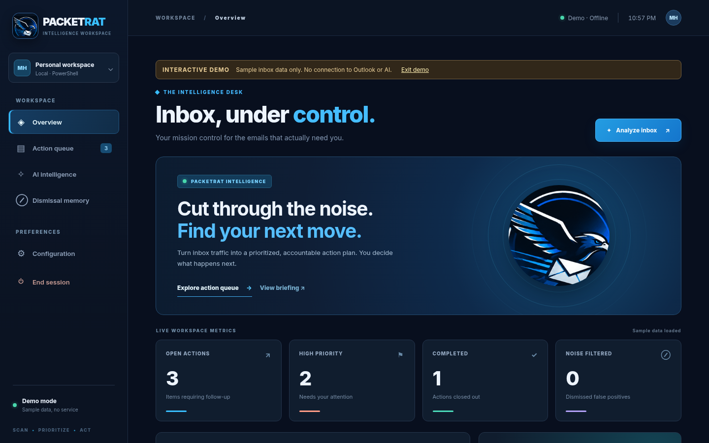
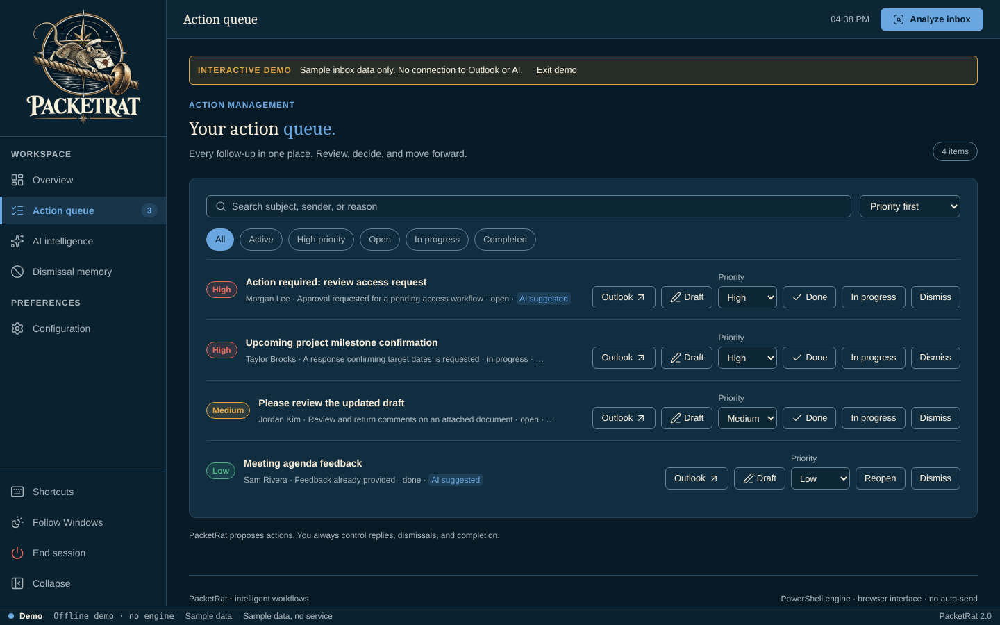
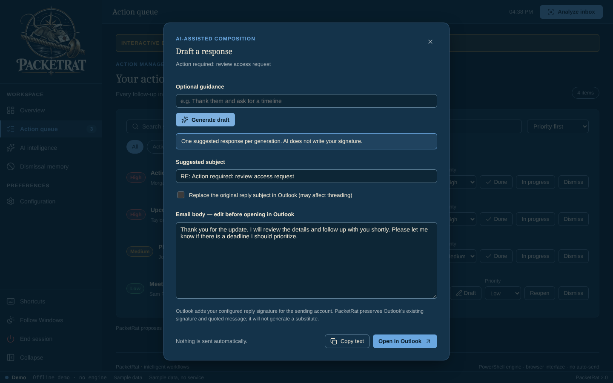
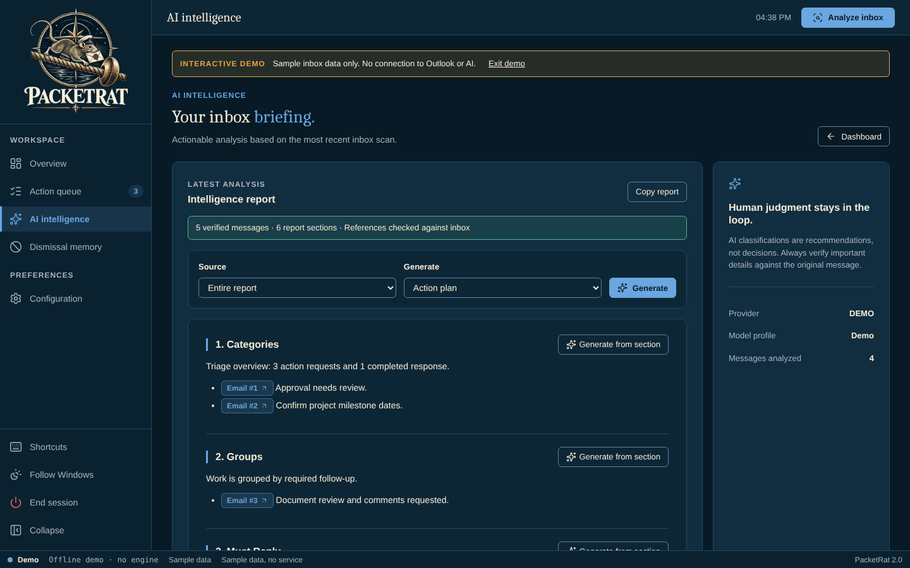
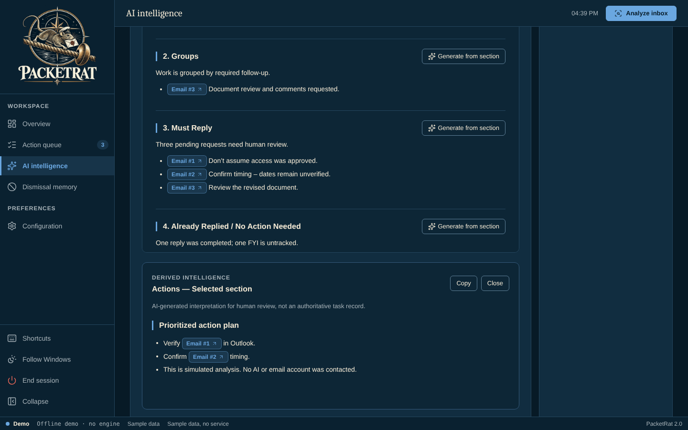
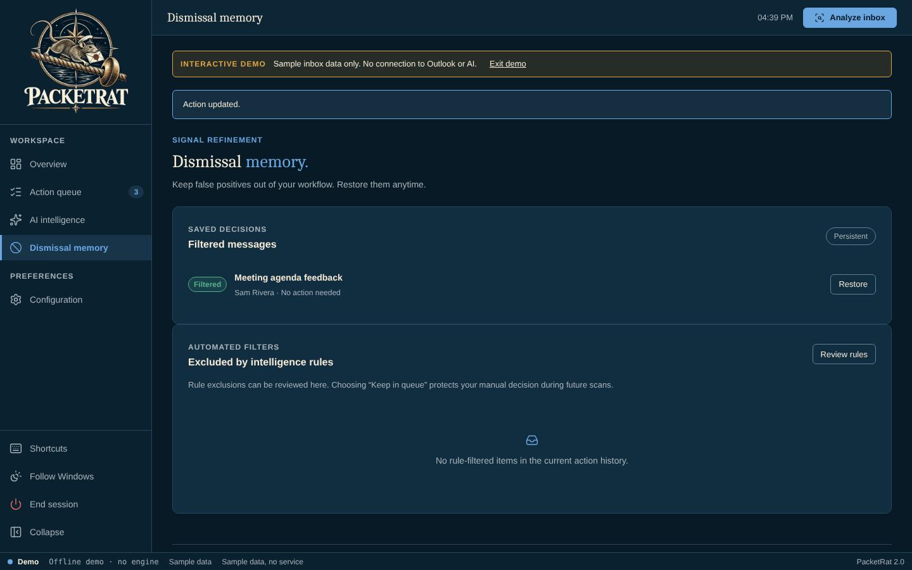
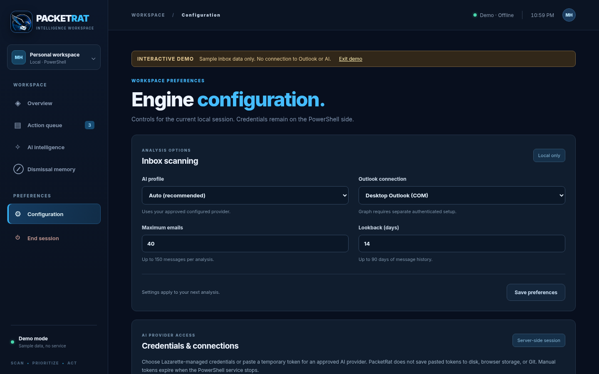

# PacketRat walkthrough

Turn an inbox scan into an action queue and an interactive, source-checked report, without sending any email on your behalf.

> **Screenshots:** captured with demo data and scanned by the Chief of Staff (team directive 10).

## Before you start

- Windows PowerShell 5.1 (part of Windows). No administrator rights and no installer.
- Microsoft Edge or Google Chrome.
- Launch: Double-click `Launch-PacketRat.bat` (or `Launch-PacketRat.bat demo` for the offline demonstration with sample messages).
- Classic Outlook and an approved AI endpoint for real use. The demo needs neither.

## Steps

### 1. First launch

PacketRat opens on **Overview** with the latest inbox metrics. In the interactive demo, a banner says only sample inbox data is used, with no connection to Outlook or AI.

### 2. Work the action queue

**Action queue** lists every follow-up by urgency and status, with buttons to open it in Outlook, draft a reply, change its priority, or mark it done, in progress or dismissed. The demo inbox also has an *Office Updates* sample message.

### 3. Draft a reply

Select **Draft** on an item. Add optional guidance, select **Generate draft**, then edit the text before you copy it or open it in Outlook. PacketRat never sends it for you.

### 4. Read the briefing

**AI intelligence** shows the report with verified links back to the source messages.

### 5. Generate a follow-up

Select a section and generate an **Action plan**, **Leadership briefing**, **Risk review** or **Explanation**.

### 6. Manage dismissals

**Dismissal memory** keeps false positives out. Restore any of them at any time. A toast confirms each change, here *Action updated*.

### 7. Check the configuration

**Configuration** shows the session settings. Credentials stay on the PowerShell side.

## About these images

Images live in [`docs/assets/walkthrough/`](../assets/walkthrough/), named `NN-<screen>.png` after the step they belong to. They are 1440x900 at 100% scale in the Night watch (dark) theme, and show demo data only. `node tools/capture-screenshots.mjs` retakes them, with the README pair in `docs/screenshots/`, from the offline demo.
